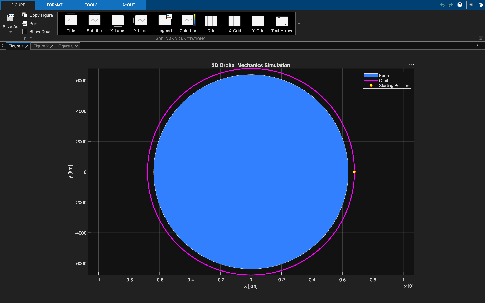

# Orbital Mechanics Simulation

MATLAB-based orbital mechanics simulator modeling spacecraft motion around Earth using two-body dynamics, numerical ODE integration, orbital parameter analysis, conservation-law validation, and collision detection.

## Features

- Simulates spacecraft motion around Earth using Newtonian two-body dynamics
- Uses MATLAB `ode45` for numerical integration
- Calculates orbital period, specific orbital energy, specific angular momentum, semi-major axis, and eccentricity
- Detects collisions with Earth using an event function
- Validates the simulation by tracking conservation of energy and angular momentum
- Visualizes the spacecraft trajectory and Earth in 2D

## Default Simulation

The default simulation begins at an altitude of 400 km with the velocity required for a circular orbit.

Example output:

- Orbital period: approximately 92.56 minutes
- Semi-major axis: 6778 km
- Eccentricity: approximately 0

## Validation

Specific orbital energy and specific angular momentum are monitored throughout the simulation. In the ideal two-body model, both quantities remain approximately constant, with only very small numerical variation from the ODE solver.

## Tools

- MATLAB
- `ode45`
- Event detection using `odeset`

## Author

Santiago Alvarez
